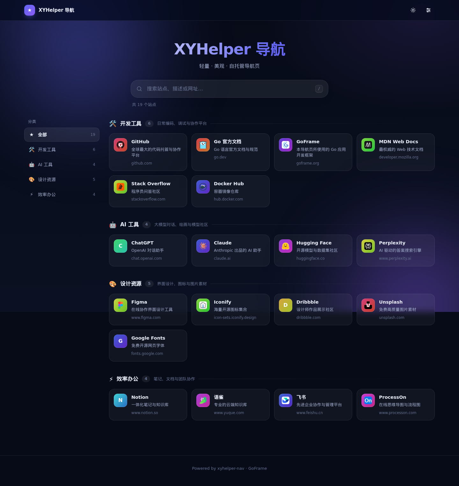
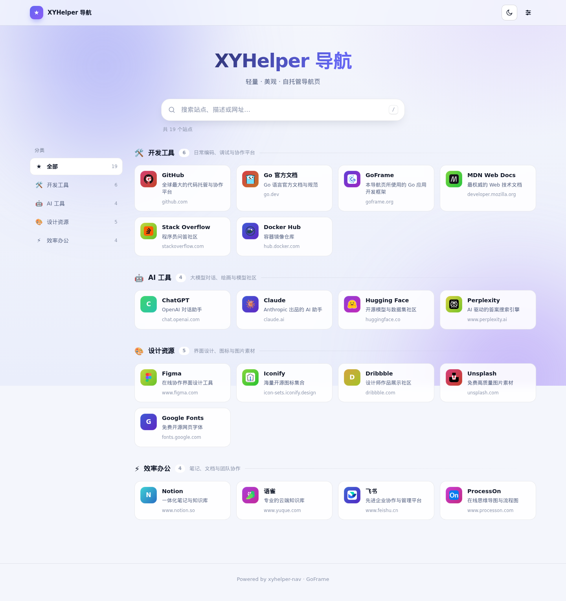
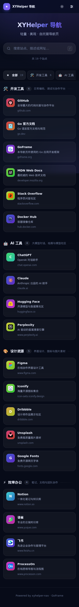
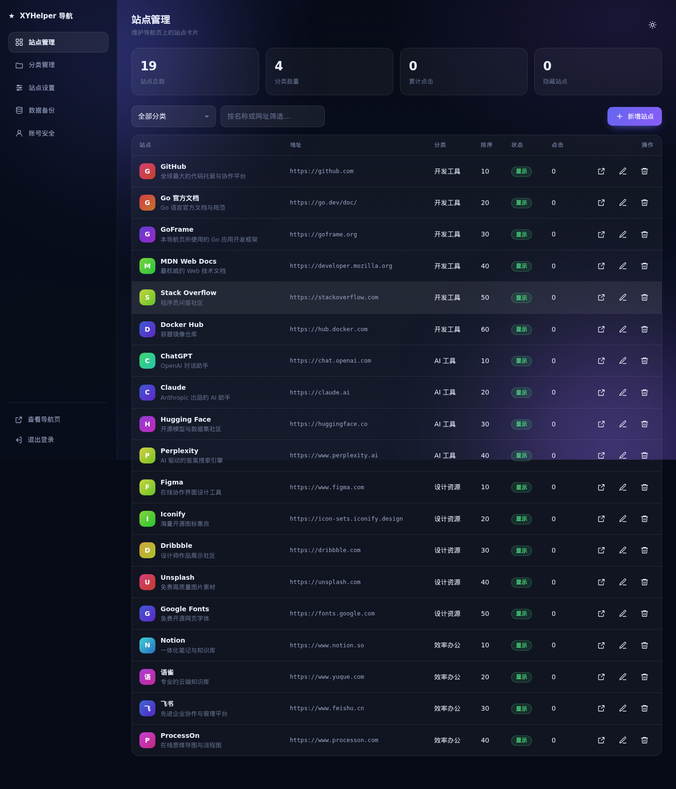
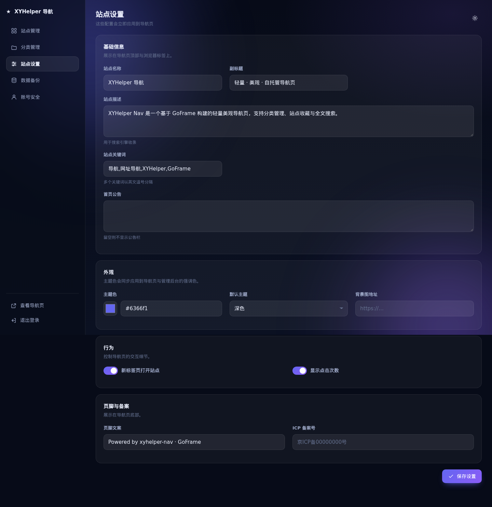
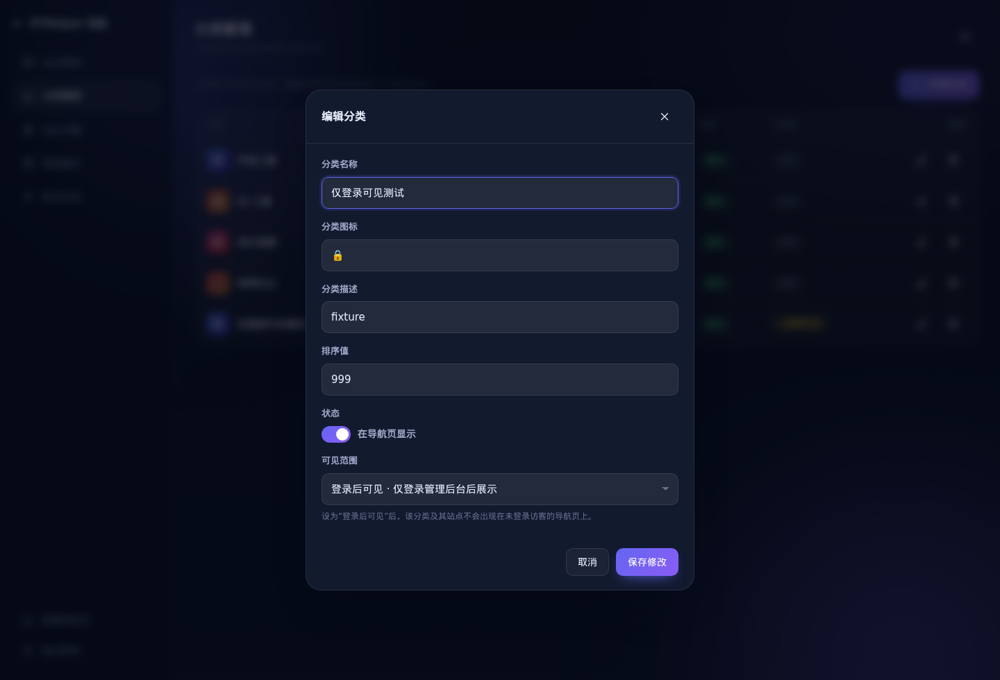

# xyhelper-nav

一个基于 **Go + GoFrame** 构建的轻量、美观、可自托管的导航页。前端零构建步骤（原生 HTML / CSS / JavaScript），后端单文件 SQLite 存储，首次启动自动建表并写入示例数据，开箱即用。



## 功能特性

- **美观的导航页**：玻璃拟态卡片、渐变主题色、深色 / 浅色主题切换、响应式布局（桌面侧边栏 / 移动端分类胶囊）。
- **图标本地缓存**：站点图标由服务端下载并缓存到本项目，浏览器只访问你自己的域名，打开页面时不再产生任何跨站请求。
- **分类级可见性**：分类可设为「公开」或「登录后可见」，后者对未登录访客完全不可见（列表、搜索、点击统计均不泄漏）。
- **即时搜索**：输入即过滤站点名称、描述与网址，命中关键字高亮；无结果时一键跳转百度 / Google / Bing 继续搜索。支持 `/` 或 `Ctrl+K` 聚焦搜索框。
- **完整的后台管理**：站点与分类的增删改查、分类可见性、可视化站点配置、数据导入导出、修改密码，全部通过内置管理面板完成。
- **点击统计**：记录每个站点的访问次数，可在配置中关闭展示。
- **零配置存储**：使用纯 Go 实现的 SQLite 驱动（无需 CGO），数据库文件、表结构与示例数据在首次启动时自动生成。
- **自动迁移与播种**：内置 `schema.sql`，每次启动都会幂等地补齐表结构与缺失的默认配置。
- **可移植备份**：一键导出全部分类、站点与配置为 JSON，并支持覆盖导入。
- **完备的接口**：所有接口均在 `/api.json`（OpenAPI）与 `/swagger`（Swagger UI）中列出，会话鉴权，统一响应结构。

## 技术栈

| 层次 | 选型 |
| --- | --- |
| 语言 | Go 1.26+ |
| 框架 | [GoFrame v2](https://goframe.org)（v2.10.3） |
| 数据库 | SQLite（[`contrib/drivers/sqlite/v2`](https://github.com/gogf/gf/tree/master/contrib/drivers/sqlite)，纯 Go，无 CGO） |
| 鉴权 | GoFrame Session + `bcrypt` 密码哈希 |
| 前端 | 原生 HTML / CSS / JavaScript，无构建步骤、无第三方运行时依赖 |

## 界面预览

| 浅色主题 | 移动端 |
| --- | --- |
|  |  |

| 后台 · 站点管理 | 后台 · 站点设置 |
| --- | --- |
|  |  |

## 快速开始

### 环境要求

- Go **1.26** 或更高版本（源码运行）；或
- Docker 20+（容器运行）

### 方式一：源码运行

```bash
git clone <your-repo> xyhelper-nav
cd xyhelper-nav

go mod download
go run main.go
```

启动后访问：

- 导航页：<http://127.0.0.1:8000/>
- 管理后台：<http://127.0.0.1:8000/admin>
- 接口文档：<http://127.0.0.1:8000/swagger>

也可以使用 Makefile：

```bash
make run          # gf run main.go，改动自动重载
make build-local  # 编译到 ./bin/nav
make test         # 运行单元测试
```

### 方式二：Docker

```bash
docker build -t xyhelper/nav:latest .
docker run -d --name xyhelper-nav \
  -p 8000:8000 \
  -v "$(pwd)/data:/app/resource/data" \
  xyhelper/nav:latest
```

### 方式三：Docker Compose（推荐）

```bash
docker compose up -d --build
```

`docker-compose.yml` 已将 `./data` 挂载到容器内的 `/app/resource/data`，数据库与登录会话都会持久化在宿主机上，升级镜像不会丢失数据。

### 默认账号

| 用户名 | 密码 |
| --- | --- |
| `admin` | `admin123` |

> ⚠️ **首次登录后请立即在「账号安全」中修改密码。** 管理员账号只会在数据库为空时创建一次。

## 目录结构

```
xyhelper-nav/
├── api/nav/v1/                 # 接口定义（请求 / 响应结构体 + 路由元信息）
├── internal/
│   ├── boot/                   # 启动引导：内嵌 schema.sql、自动建表、播种数据
│   ├── cmd/                    # 命令入口、路由注册、静态资源挂载
│   ├── consts/                 # 常量与默认配置
│   ├── controller/
│   │   ├── admin/              # 后台接口控制器
│   │   └── nav/                # 前台接口控制器
│   ├── dao/                    # 数据访问对象（gf gen dao 生成）
│   ├── logic/                  # 业务实现（service 接口的实现者）
│   ├── middleware/             # 鉴权、跨域中间件
│   ├── model/                  # 领域模型、输入结构体、entity / do
│   └── service/                # 业务接口定义
├── manifest/
│   ├── config/config.yaml      # 应用配置
│   └── deploy/kustomize/       # Kubernetes 部署清单
├── resource/
│   ├── data/                   # 运行时数据（已 gitignore）：数据库、图标缓存、会话
│   └── public/                 # 前端页面与静态资源
├── docs/images/                # 文档截图
├── Dockerfile
├── docker-compose.yml
└── main.go
```

## 配置说明

### 应用配置 `manifest/config/config.yaml`

```yaml
server:
  address:     ":8000"          # 监听地址
  indexFiles:  ["index.html"]
  openapiPath: "/api.json"      # OpenAPI 描述文件地址
  swaggerPath: "/swagger"       # Swagger UI 地址

  sessionIdName:       "xyhelper-nav-sid"
  sessionMaxAge:       "7d"     # 会话有效期
  sessionCookieMaxAge: "7d"
  sessionPath:         "resource/data/sessions"

  # 前端静态资源目录，默认 resource/public。
  # 由程序自行解析，目录不存在时只关闭前端而不影响接口服务。
  # serverRoot: "resource/public"

logger:
  level:  "all"
  stdout: true

database:
  default:
    link:  "sqlite::@file(resource/data/nav.db)"
    debug: false

# 站点图标缓存：服务端下载一次后本地提供，访客浏览器不会访问第三方站点。
icon:
  path:            "resource/data/icons"
  timeout:         "8s"
  maxSize:         524288      # 512 KiB，超过则拒绝
  retryInterval:   "10m"       # 下载失败后的重试间隔
  refreshInterval: "720h"      # 缓存 30 天后自动重新拉取
```

### 站点设置

以下配置保存在 `nav_setting` 表，可直接在后台「站点设置」中修改，即时生效。

| 配置项 | 键名 | 说明 |
| --- | --- | --- |
| 站点名称 | `site_name` | 导航页标题、页头与浏览器标签 |
| 副标题 | `site_subtitle` | 首页标题下方的描述文字 |
| 站点描述 | `site_description` | 用于搜索引擎收录（meta description） |
| 站点关键词 | `site_keywords` | 多个关键词以英文逗号分隔 |
| 首页公告 | `announcement` | 留空则不显示公告栏 |
| 主题色 | `theme_color` | 十六进制色值，如 `#6366f1` |
| 默认主题 | `default_theme` | `dark` 或 `light` |
| 背景图地址 | `background_image` | 留空则使用默认渐变背景 |
| 新标签页打开站点 | `open_new_tab` | `1` 开启 / `0` 关闭 |
| 显示点击次数 | `show_hits` | `1` 开启 / `0` 关闭 |
| 页脚文案 | `site_footer` | 展示在导航页底部 |
| ICP 备案号 | `icp` | 展示在页脚，留空则不显示 |

## 图标缓存

导航页上的图标**不会**由浏览器直接向第三方站点请求。流程如下：

1. 页面里的 `` 指向本站地址 `/api/v1/nav/icon/{站点ID}?v={缓存键}`；
2. 该地址首次被访问时，服务端按「站点填写的图标地址 → 否则站点自身的 `/favicon.ico`」下载图标，落盘到 `resource/data/icons/`，并把文件名记录到 `nav_site.icon_key`；
3. 之后所有访问都直接从本地磁盘返回，不再产生外部请求。

由此带来两个直接好处：访客的浏览器不再因为打开导航页而向几十个第三方域名暴露访问行为；页面加载也不再受外部站点速度影响（命中缓存时本地返回约 1ms）。

细节说明：

- **文件名按内容哈希生成**（`<sha256 前 16 位>.<扩展名>`），相同图标只存一份，并且地址变化即代表图标变化，因此响应带 `Cache-Control: public, max-age=604800`，浏览器可长期缓存。
- **下载失败不会影响页面**：失败的站点会回退为按名称生成的渐变字母图标，并在 `retryInterval`（默认 10 分钟）内不再重试，避免反复请求已经失效的地址。
- **自动刷新**：缓存超过 `refreshInterval`（默认 30 天）后会在下一次访问时重新拉取；后台「站点管理 → 刷新图标」可立即强制刷新全部站点。
- **修改站点地址或图标地址**时，旧缓存会被自动清除。
- **支持格式**：PNG / JPEG / GIF / WebP / SVG / ICO / AVIF，单文件上限 `maxSize`（默认 512 KiB）。当对方返回 `application/octet-stream` 之类的通用类型时，会改为按文件内容识别格式。
- **安全**：图标文件名由服务端生成并做白名单校验，不存在路径穿越；SVG 响应额外附加 `Content-Security-Policy`，即使图标里含有脚本也不会在本站域名下执行。

> 站点图标来自第三方站点，其版权归各自所有者所有。

## 分类可见性（登录后可见）

分类支持两种可见范围，可在后台「分类管理」中新增或编辑时设置：

| 可见范围 | `visibility` | 说明 |
| --- | --- | --- |
| 公开（默认） | `0` | 所有人可见 |
| 登录后可见 | `1` | 仅登录管理后台后可见 |



该规则在**服务端**统一生效，未登录访客无法通过任何途径获取受保护内容：

- `GET /api/v1/nav/index` 不会返回该分类及其站点，站点总数与分类计数同步扣除；
- `GET /api/v1/nav/search` 不会检索到这些站点；
- `POST /api/v1/nav/hit` 对受保护站点返回「站点不存在」，避免通过遍历 ID 拿到地址；
- 后台接口始终可以看到全部内容。

登录状态由管理后台的会话 Cookie 判定：只要浏览器中保留着有效的管理员会话，访问导航页即可看到「登录后可见」的分类——因此可以直接用导航页当作私人书签页使用。删除会话（退出登录）后立即恢复为访客视图。

> 提示：该功能用于「不公开列出」，并非强密码保护。受保护站点的地址仍保存在服务端数据库中，请勿将敏感的明文凭据写入站点名称或描述。

## API 一览

所有接口以 `/api/v1` 为前缀，统一返回 `{"code":0,"message":"OK","data":{...}}`；`code` 非 0 表示失败，`message` 为错误原因。

### 前台接口

| 方法 | 路径 | 说明 |
| --- | --- | --- |
| GET | `/api/v1/nav/index` | 获取导航页全部数据（配置 + 分类 + 站点） |
| GET | `/api/v1/nav/search?keyword=&limit=` | 按关键字搜索站点 |
| GET | `/api/v1/nav/icon/{id}` | 获取站点图标（本地缓存，首次访问时自动下载） |
| POST | `/api/v1/nav/hit` | 记录一次站点点击，返回最新点击数 |

### 后台接口（需登录）

| 方法 | 路径 | 说明 |
| --- | --- | --- |
| POST | `/api/v1/admin/login` | 登录并建立会话 |
| POST | `/api/v1/admin/logout` | 退出登录 |
| GET | `/api/v1/admin/profile` | 获取当前管理员 |
| PUT | `/api/v1/admin/profile` | 修改昵称 |
| POST | `/api/v1/admin/password` | 修改密码 |
| GET | `/api/v1/admin/categories` | 分类列表（含站点） |
| POST | `/api/v1/admin/category` | 新增分类（`visibility` 可选，1 表示登录后可见） |
| PUT | `/api/v1/admin/category` | 更新分类（含可见性） |
| DELETE | `/api/v1/admin/category?id=` | 删除分类及其站点 |
| GET | `/api/v1/admin/sites?categoryId=&keyword=` | 站点列表 |
| POST | `/api/v1/admin/site` | 新增站点 |
| PUT | `/api/v1/admin/site` | 更新站点 |
| DELETE | `/api/v1/admin/site?id=` | 删除站点 |
| POST | `/api/v1/admin/icons/refresh` | 刷新图标缓存（`id` 为 0 表示全部站点） |
| GET | `/api/v1/admin/settings` | 获取站点配置 |
| PUT | `/api/v1/admin/settings` | 保存站点配置 |
| GET | `/api/v1/admin/backup/export` | 导出全站数据 |
| POST | `/api/v1/admin/backup/import` | 导入并覆盖全站数据 |

## 数据存储与备份

- 数据库文件：`resource/data/nav.db`（SQLite，首次启动自动创建）
- 图标缓存：`resource/data/icons/`（服务端下载的站点图标，可随时删除，会按需重新下载）
- 会话文件：`resource/data/sessions/`
- 表结构定义：[`internal/boot/schema.sql`](internal/boot/schema.sql)，由程序内嵌并在每次启动时幂等执行

数据表：

| 表名 | 说明 |
| --- | --- |
| `nav_category` | 分类（`visibility` 字段区分公开 / 登录可见） |
| `nav_site` | 站点（`icon` 为图标来源，`icon_key` 为本地缓存文件） |
| `nav_setting` | 站点配置（键值对） |
| `nav_admin` | 管理员账号 |

备份方式：

1. **后台导出（推荐）**：管理后台 →「数据备份」→ 导出 JSON，包含分类、站点与全部配置。图标缓存无需备份，导入后会在首次访问时自动重新下载（也可点击「刷新图标」预热）。
2. **直接复制数据库**：停止服务后复制 `resource/data/nav.db` 即可；如需连同图标一起迁移，一并复制 `resource/data/icons/`。

## 开发指南

本项目遵循 GoFrame 的分层约定：`api`（接口定义）→ `controller`（参数处理）→ `service`（接口）→ `logic`（实现）→ `dao`（数据访问）。

```bash
# 安装 GoFrame CLI
make cli

# 修改 internal/boot/schema.sql 后，重新生成 DAO / DO / Entity
make dao

# 生成 service 接口的空实现
make service

# 运行测试
make test

# 格式化代码
make fmt
```

修改数据库结构后，请同步更新 `internal/boot/schema.sql` 与 `hack/config.yaml` 中的 `gfcli.gen.dao` 配置，再执行 `make dao`。

## 部署

### 编译二进制

```bash
# 本机
go build -trimpath -ldflags "-s -w" -o bin/nav .

# 交叉编译 Linux amd64
CGO_ENABLED=0 GOOS=linux GOARCH=amd64 \
  go build -trimpath -ldflags "-s -w" -o bin/nav .
```

运行时需保证工作目录下存在 `manifest/config/config.yaml` 与 `resource/public`（程序也会尝试从可执行文件所在目录查找静态资源）。

### Kubernetes

`manifest/deploy/kustomize` 提供了 Kustomize 清单：

```bash
kubectl apply -k manifest/deploy/kustomize/overlays/develop
```

修改 `overlays/develop/configmap.yaml` 可覆盖容器内配置，`base/pvc.yaml` 用于持久化 SQLite 数据。

## 常见问题

**Q：端口被占用 / 想换端口？**
修改 `manifest/config/config.yaml` 中的 `server.address`，例如 `":9000"`。

**Q：忘记管理员密码？**
停止服务后删除数据库中的管理员记录，重启后会重新创建默认账号：

```bash
sqlite3 resource/data/nav.db "DELETE FROM nav_admin;"
```

**Q：站点图标不显示 / 显示为字母？**
未填写图标地址时，服务端会尝试下载站点自身的 `/favicon.ico`；对方没有该文件（例如 Notion、ChatGPT）或下载失败时，就会回退为按名称生成的渐变字母图标。可以在后台为该站点手动填写一个可访问的图标地址，然后点击「刷新图标」。详见[图标缓存](#图标缓存)。

**Q：站点卡片上的点击次数一直不显示？**
点击次数为 0 时不会展示；同时请确认「站点设置 → 显示点击次数」处于开启状态。

**Q：如何让某些分类只在登录后才能看到？**
后台「分类管理」→ 新增 / 编辑分类 → 可见范围选择「登录后可见」。详见[分类可见性](#分类可见性登录后可见)。

**Q：升级后数据库需要手动改表吗？**
不需要。程序启动时会自动补齐缺失的字段（日志中会出现 `schema updated: added column ...`），已有数据不受影响。

**Q：前端资源 404？**
确认运行目录下 `resource/public` 存在。若程序无法找到该目录，启动日志中会出现 `static root ... not found` 警告，此时接口仍可正常访问。

## 协议

MIT
